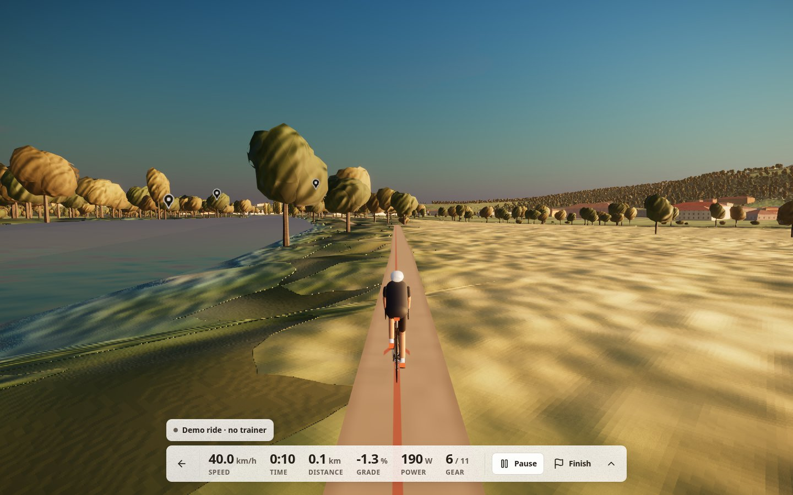
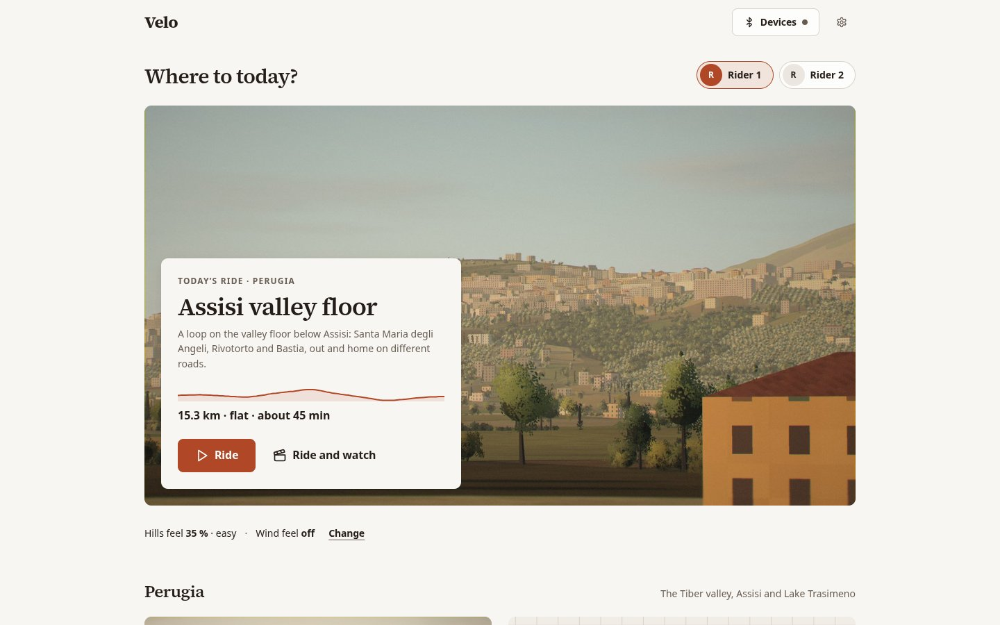
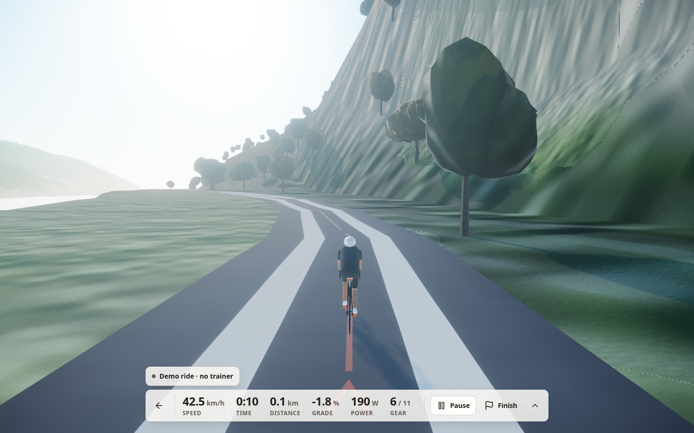

<div align="center">

# Velo

**Ride real places in your browser, on your own smart trainer. No subscription, no account, no token.**

[](LICENSE)
[](https://github.com/Custodia-Admin/velo/actions/workflows/ci.yml)

</div>

Velo is a fork of [GlobeRide](https://github.com/masonwyatt23/globeride) by
Mason Wyatt, an open-source browser cycling simulator with a Cesium 3D globe
and Web Bluetooth trainer control. Velo keeps GlobeRide's ride engine (trainer
control, physics, FIT export) and adds its own 3D worlds, baked from open data,
so the 3D ride needs no map token.

**Try it: https://velo-trainer.pages.dev.** Nothing to install and no
account. Pair a trainer from Chrome or Edge, or let the demo rider ride.

## Why it exists

A household with one smart trainer wanted what Zwift gives (somewhere pretty
to ride, something to watch, a trainer that feels the hills) without a
monthly subscription, and without signing up to a map provider for a token
either. So Velo bakes real places into small 3D worlds from open data and
ships them with the app. Everything runs in the browser. Rides, riders and
settings stay on the device.



| | |
| --- | --- |
|  |  |
| Home: pick who's riding, then a ride | The Lugano lakefront, Lugano world |

## What it does

- **Baked 3D worlds.** Perugia (Umbria) and Lugano (Ticino) ship in the repo.
  Lake Trasimeno, Valle Maggia, the Magadino plain, Lake Varese, Lake Como,
  Chengdu's Luxe Lakes, the Cuyahoga Valley towpath, the Cleveland lakefront,
  the Berkeley Bay Trail, Santa Monica and Venice, and Puerto Vallarta are
  fetched on their first ride and ride offline after that. Terrain, roads,
  water, buildings and trees come from OpenStreetMap and open elevation data.
  27 scenic routes, most of them flat or gently rolling; the ones outside a
  baked world ride on an OpenStreetMap map.
- **Your trainer feels the road.** Any FTMS smart trainer over Web Bluetooth
  (Wahoo KICKR, Tacx, Elite, Zwift Hub and others) gets the route's gradient,
  with virtual gears and a "hills feel" setting to soften climbs. Heart-rate
  straps work too. Handlebar controllers can shift and steer.
- **Time of day and weather.** Live weather at the route's start, or pick the
  light and the sky yourself.
- **Something to watch.** Show mode plays your own videos over the ride.
  Journey mode floats the ride in a small window over another tab (Chrome and
  Edge on desktop), so you can ride while a show plays.
- **Big-screen layout.** A TV layout with overscan-safe margins and
  remote/keyboard navigation.
- **No trainer?** A demo rider rides the route so you can look around.
- **Two riders, one trainer.** Each rider has their own name, colours and
  ride history, kept in the browser only.
- **Export** finished rides as .FIT files, ready for Strava or Garmin Connect.

## Quick start

You need Node 24 (what CI uses) and npm. No `.env` file, key or token is needed.

```bash
git clone https://github.com/Custodia-Admin/velo.git
cd velo
npm ci
npm run dev          # http://localhost:5173
```

Open http://localhost:5173/app, pick a ride, and the demo rider starts. To
ride for real, open **Devices** (the trainer button at the top of Home) and
press **Pair**.

| Command | What it does |
| --- | --- |
| `npm run dev` | Dev server on :5173 |
| `npm run check` | Typecheck, lint and unit tests: run it before you push |
| `npm run build` | Static build in `dist/` |
| `npm run preview` | Serve the build on :4173 |
| `npx playwright test` | End-to-end tests (Chromium) |

### Self-hosting

`npm run build` writes a static site to `dist/`. Serve it from any static host
that falls back to `index.html` for unknown paths. The public site runs on
Cloudflare Pages, deployed from each release tag; [DEPLOY.md](DEPLOY.md) has
the steps, for this site and for your own copy. Remote worlds load from the
project's public bucket; point `VITE_WORLDS_REMOTE_URL` at your own mirror if
you'd rather host them.

### Optional settings

All optional; see [`.env.example`](.env.example). A free
[Cesium ion](https://ion.cesium.com/tokens) token adds the photoreal Cesium
globe for routes outside a baked world. The AI coach and commentary that
came with GlobeRide need an xAI key or a local Ollama.

## Add your own hometown

A world is a recipe (a bounding box, the routes to fit, a few choices) and a
bake that turns open data into a bundle the app loads: OpenStreetMap for roads,
water, buildings and land cover, Copernicus GLO-30 or AWS terrain tiles for
elevation. No API key. The guide walks through it, from the recipe to a ride:
[docs/worlds/ADDING-A-WORLD.md](docs/worlds/ADDING-A-WORLD.md). The bundle
format is in [docs/worlds/WORLD-FORMAT.md](docs/worlds/WORLD-FORMAT.md).

## Web Bluetooth

Trainer, heart-rate and controller pairing use Web Bluetooth.

- **Works in** Chrome and Edge on Windows, macOS, ChromeOS and Android.
- **Not in** Safari, Firefox or any browser on iOS/iPadOS. Velo still runs
  there, with the demo rider.
- **Linux:** turn on `chrome://flags/#enable-web-bluetooth` and nothing else.
  The neighbouring `#enable-web-bluetooth-new-permissions-backend` flag breaks
  the device chooser (it scans for half a second and lists nothing). Without
  it, Chrome on Linux can't reconnect a device silently after a reload, so
  Velo shows a Reconnect button instead. Details:
  [docs/devices/zwift-ride-v2.md](docs/devices/zwift-ride-v2.md#platforms-what-reconnects-silently-where).
- Only one app can control a trainer at a time: close Zwift, the maker's app
  or another tab before you pair.

## Privacy

No accounts and no backend. Riders, rides and settings live in the browser's
localStorage and IndexedDB. The app talks to the network for world bundles,
for the weather forecast (Open-Meteo, which you can turn off), and for the
optional services you set up yourself. The full list is in
[docs/worlds/CREDITS.md](docs/worlds/CREDITS.md#services-the-app-calls-at-ride-time).

## Contributing

Issues and pull requests are welcome; read [CONTRIBUTING.md](CONTRIBUTING.md)
first. The project follows the [Code of Conduct](CODE_OF_CONDUCT.md).

## Credits and licence

- Code: [MIT](LICENSE), © Mason Wyatt (GlobeRide) and © Federico Brooks (Velo).
- World data: © OpenStreetMap contributors (ODbL); produced using Copernicus
  WorldDEM-30 © DLR e.V. 2010-2014 and © Airbus Defence and Space GmbH
  2014-2018 provided under COPERNICUS by the European Union and ESA, all
  rights reserved; U.S. Geological Survey 3DEP; Source: Federal Office of
  Topography swisstopo (swissALTI3D); DTM 5x5 © Regione Lombardia (CC BY 4.0);
  LiDAR DTM 1 m © MASE – Geoportale Nazionale (CC BY 4.0); RGE ALTI® © IGN
  (Licence Ouverte 2.0); DTM LiDAR 5 m © Regione del Veneto (IODL 2.0);
  Mapzen/AWS terrain tiles; OSRM. Weather
  data by Open-Meteo.com (CC BY 4.0).
- Every source, licence and attribution: [NOTICE.md](NOTICE.md) and
  [docs/worlds/CREDITS.md](docs/worlds/CREDITS.md).

Velo isn't affiliated with Zwift, Wahoo or any trainer maker. Their names
appear only to say what works.
